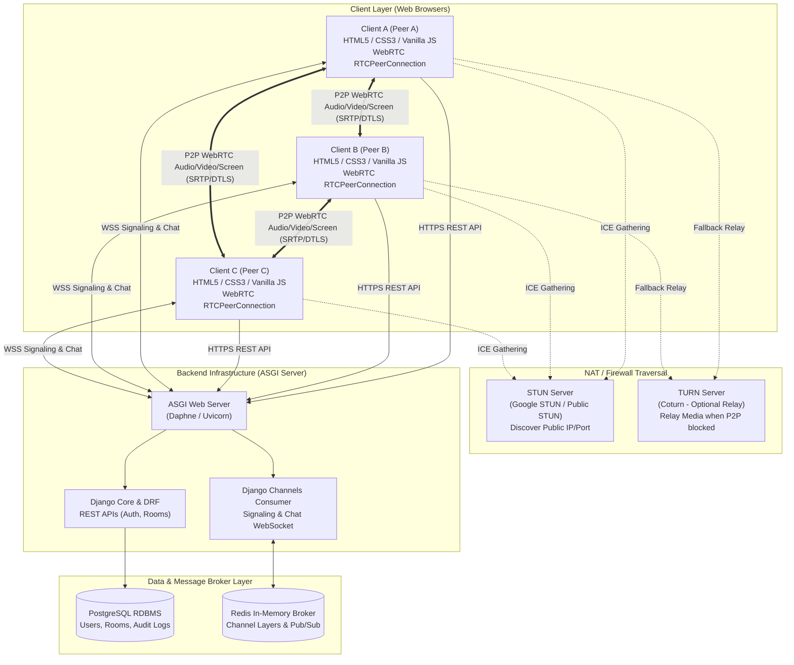
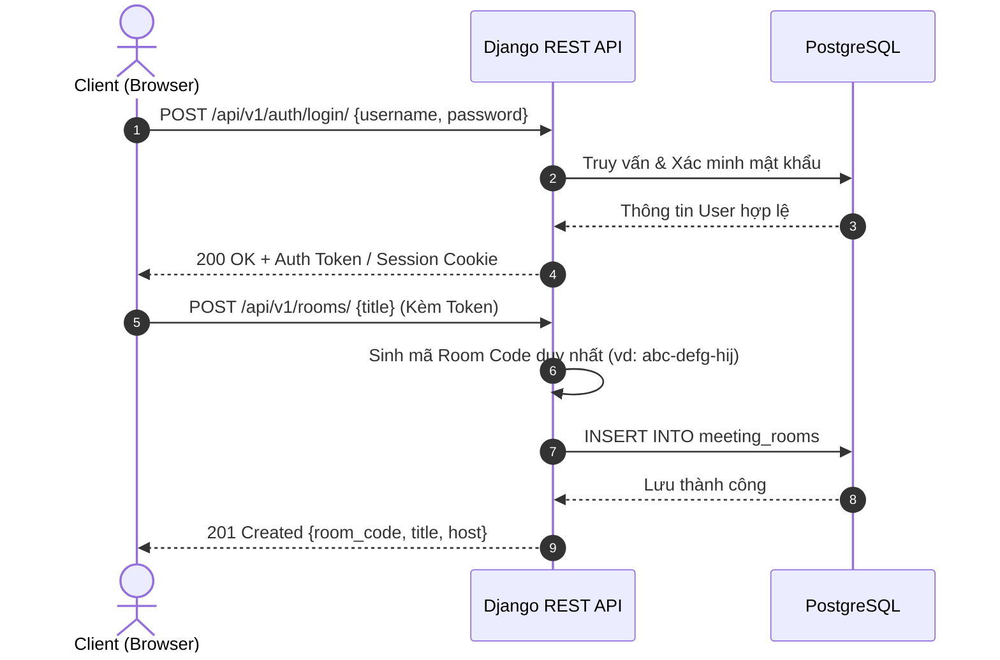

# THIẾT KẾ KIẾN TRÚC HỆ THỐNG (SYSTEM ARCHITECTURE)
## DỰ ÁN: AI MEETING

---

## 1. TỔNG QUAN KIẾN TRÚC

Hệ thống **AI Meeting** được thiết kế theo kiến trúc lai kết hợp giữa **Mô hình Client–Server phân tán** (dành cho quản lý dữ liệu, xác thực và Signaling) và **Mô hình mạng lưới ngang hàng P2P Full Mesh** (dành cho truyền tải dữ liệu truyền thông đa phương tiện Media WebRTC).

Sự phân tách này đảm bảo:
- Máy chủ backend tập trung vào việc quản lý logic nghiệp vụ, bảo mật, và điều phối tín hiệu (Signaling), không bị quá tải bởi việc xử lý chuyển tiếp video/audio nặng nề.
- Trình duyệt phía Client trực tiếp kết nối và truyền dữ liệu video/audio cho nhau với độ trễ thấp nhất có thể ($\le 300\text{ms}$).

---

## 2. CÁC THÀNH PHẦN HỆ THỐNG (COMPONENTS)



### 2.1. Chi tiết các thành phần
1. **Frontend Client (Trình duyệt người dùng):**
   - Công nghệ: HTML5, CSS3 hiện đại, Vanilla JavaScript (ES6+ Modules). Không phụ thuộc framework nặng nề, đảm bảo tải trang nhanh và kiểm soát trực tiếp các API trình duyệt.
   - Thư viện Web API chuẩn:
     - `navigator.mediaDevices.getUserMedia()`: Thu thập audio/video từ microphone và webcam.
     - `navigator.mediaDevices.getDisplayMedia()`: Thu thập luồng chia sẻ màn hình.
     - `RTCPeerConnection`: Quản lý vòng đời kết nối WebRTC, mã hóa và giải mã SRTP/DTLS.
     - `WebSocket API`: Duy trì kết nối hai chiều liên tục với backend.

2. **Backend Server (Django & Django REST Framework - DRF):**
   - Công nghệ: Python 3.14+, Django 5+, Django REST Framework 3.18+.
   - Nhiệm vụ: Xử lý các yêu cầu HTTP đồng bộ/bất đồng bộ về xác thực người dùng, cấp phát token, CRUD thông tin phòng họp, xác thực quyền truy cập.

3. **Realtime Signaling (Django Channels & Daphne):**
   - Công nghệ: Django Channels 4+, Daphne ASGI Server.
   - Nhiệm vụ:
     - Duy trì hàng nghìn kết nối WebSocket đồng thời.
     - Điều phối thông điệp Signaling: `join_room`, `offer`, `answer`, `ice_candidate`, `user_left`.
     - Phân phối tin nhắn In-room Chat tức thời.

4. **Message Broker (Redis):**
   - Công nghệ: Redis Server và thư viện `channels-redis`.
   - Nhiệm vụ: Đóng vai trò là Pub/Sub Message Broker cho Django Channels. Cho phép hệ thống mở rộng theo chiều ngang (scale-out) trên nhiều worker Daphne/Channels mà vẫn đồng bộ được trạng thái phòng họp.

5. **Cơ sở dữ liệu (PostgreSQL):**
   - Công nghệ: PostgreSQL 16+.
   - Nhiệm vụ: Lưu trữ bền vững dữ liệu quan hệ (Người dùng, Phòng họp, Thành viên, Lịch sử).

6. **Hạ tầng NAT Traversal (STUN / TURN Server):**
   - **STUN (Session Traversal Utilities for NAT):** Cho phép client phát hiện địa chỉ IP Public và Port của chính mình để cung cấp cho đối tác kết nối (Google STUN: `stun:stun.l.google.com:19302`).
   - **TURN (Traversal Using Relays around NAT):** Đóng vai trò là trạm tiếp phát dữ liệu khi hai client nằm sau NAT đối xứng (Symmetric NAT) hoặc Firewall doanh nghiệp nghiêm ngặt không thể kết nối P2P trực tiếp.

---

## 3. CÁC LUỒNG DỮ LIỆU CHÍNH (DATA FLOWS)

### 3.1. Luồng HTTP REST API (Xác thực & Tạo phòng)


---

### 3.2. Luồng WebSocket Signaling & Khởi tạo WebRTC Mesh
Mô hình đàm phán tín hiệu giữa Client A (đã có trong phòng) và Client B (vừa tham gia vào phòng):

```mermaid
sequenceDiagram
    autonumber
    actor PeerB as Client B (New Peer)
    participant WS as Django Channels (Signaling)
    actor PeerA as Client A (Existing Peer)

    Note over PeerB, WS: 1. Client B kết nối WebSocket vào phòng
    PeerB->>WS: WebSocket Connect /ws/meeting/{room_code}/
    WS-->>PeerB: 101 Switching Protocols
    PeerB->>WS: Send JSON: { type: "join_room", payload: { peer_id: "uuid-B", name: "User B" } }

    WS->>PeerB: Send JSON: { type: "room_state", payload: { peers: ["uuid-A"] } }
    WS->>PeerA: Broadcast JSON: { type: "user_joined", payload: { peer_id: "uuid-B", name: "User B" } }

    Note over PeerA, PeerB: 2. Quá trình bắt tay WebRTC (Client B chủ động gửi Offer tới Client A)
    PeerB->>PeerB: Tạo RTCPeerConnection cho Peer A<br/>Tạo SDP Offer
    PeerB->>WS: Send JSON: { type: "offer", payload: { target_peer_id: "uuid-A", sdp: offerSDP } }
    WS->>PeerA: Route JSON: { type: "offer", payload: { sender_peer_id: "uuid-B", sdp: offerSDP } }

    PeerA->>PeerA: Nhận Offer -> SetRemoteDescription<br/>Tạo SDP Answer
    PeerA->>WS: Send JSON: { type: "answer", payload: { target_peer_id: "uuid-B", sdp: answerSDP } }
    WS->>PeerB: Route JSON: { type: "answer", payload: { sender_peer_id: "uuid-A", sdp: answerSDP } }

    Note over PeerA, PeerB: 3. Trao đổi ICE Candidates
    PeerB->>WS: Send JSON: { type: "ice_candidate", payload: { target_peer_id: "uuid-A", candidate: candB } }
    WS->>PeerA: Route ICE Candidate cho Peer A
    PeerA->>WS: Send JSON: { type: "ice_candidate", payload: { target_peer_id: "uuid-B", candidate: candA } }
    WS->>PeerB: Route ICE Candidate cho Peer B

    Note over PeerA, PeerB: 4. Thiết lập P2P Media Direct Channel
    PeerA<=>>PeerB: WebRTC Connected! Truyền trực tiếp Audio / Video / Screen (SRTP)
```

---

## 4. MÔ HÌNH TRUYỀN THÔNG MEDIA: FULL MESH CHO NHÓM NHỎ

### 4.1. Bản chất mô hình Full Mesh
Trong mô hình Full Mesh:
- Không có bất kỳ máy chủ trung gian nào xử lý hay chuyển tiếp gói tin âm thanh/hình ảnh.
- Mỗi client trong phòng thiết lập một kết nối `RTCPeerConnection` trực tiếp riêng biệt tới từng client khác.
- Với phòng có $N$ người tham gia:
  - Tổng số kết nối P2P trong phòng là: $\frac{N(N - 1)}{2}$ kết nối.
  - Mỗi client phải gửi đi $N - 1$ luồng upload và nhận về $N - 1$ luồng download.

```
       [Client A]
        /      \
       /        \
      /          \
  [Client B]----[Client C]
 (3 người = 3 kết nối trực tiếp)
```

### 4.2. So sánh với kiến trúc SFU / MCU & Lý do chọn Full Mesh
| Tiêu chí so sánh | WebRTC Full Mesh (Lựa chọn hiện tại) | SFU (Selective Forwarding Unit) | MCU (Multipoint Control Unit) |
| :--- | :--- | :--- | :--- |
| **Chi phí máy chủ** | **Gần như bằng 0** (Server chỉ làm signaling nhẹ) | Rất cao (Tốn băng thông Internet của Server) | Cực cao (Server phải giải mã, mix và mã hóa lại video) |
| **Độ trễ truyền thông** | **Thấp nhất** (Đi trực tiếp peer-to-peer qua đường mạng ngắn nhất) | Thấp (Đi qua server trung gian) | Cao (Do server phải xử lý compositing/transcoding) |
| **Mức độ phức tạp backend**| **Thấp** (Chỉ cần WebSocket signaling) | Rất cao (Phải triển khai Mediasoup / Janus / Pion) | Cực kỳ phức tạp |
| **Giới hạn số người/phòng** | **4 đến 6 người tối đa** | 20 đến 100+ người | 50 đến 500+ người |
| **Tải phần cứng Client** | Tăng theo $O(N)$ cho CPU & Băng thông upload | Ổn định (Client chỉ gửi 1 luồng upload duy nhất) | Rất nhẹ cho client |

**Kết luận kiến trúc:** Kiến trúc Full Mesh là lựa chọn tối ưu tuyệt đối cho giai đoạn hiện tại (Tuần 1–6) vì tiết kiệm tối đa tài nguyên máy chủ, triển khai nhanh chóng, bảo mật P2P đầu-cuối (End-to-End Encryption mặc định) và hoàn toàn đáp ứng tốt cho các buổi họp nhóm nhỏ ($\le 6$ người). **Tuyệt đối không triển khai máy chủ SFU nếu chưa được phê duyệt chính thức.**

---

## 5. VAI TRÒ CỦA STUN / TURN VÀ VƯỢT LỬA NAT (NAT TRAVERSAL)

### 5.1. Vấn đề NAT (Network Address Translation)
Hầu hết các thiết bị máy tính của người dùng cá nhân đều nằm sau Router gia đình hoặc mạng nội bộ (LAN/WiFi), chỉ có địa chỉ IP riêng (Private IP như `192.168.x.x`, `10.x.x.x`). Hai thiết bị ở hai mạng khác nhau không thể nhìn thấy địa chỉ IP thật của nhau nếu không có cơ chế trung gian.

### 5.2. Vai trò của STUN
- STUN Server là một dịch vụ công cộng có IP tĩnh trên Internet.
- Client gửi một gói tin UDP tới STUN. STUN sẽ đọc địa chỉ IP Public và Port xuất phát của gói tin đó rồi phản hồi lại cho Client.
- Nhờ đó, Client biết được địa chỉ Public của chính mình để gửi trong ICE Candidate qua Signaling Server cho đối tác.
- STUN hoạt động tốt với mạng Full Cone NAT, Restricted Cone NAT, Port Restricted Cone NAT (chiếm khoảng 85-90% các kết nối gia đình/di động thông thường).

### 5.3. Vai trò của TURN và Giới hạn kết nối
- Khi Client nằm sau **NAT đối xứng (Symmetric NAT)** (thường thấy trong mạng bảo mật của các cơ quan, trường đại học lớn hoặc mạng 4G/5G một số nhà mạng): IP/Port của kết nối thay đổi liên tục theo từng đích đến. Lúc này kết nối P2P trực tiếp **hoàn toàn thất bại**.
- **Giải pháp TURN:** TURN Server đóng vai trò là một máy chủ Relay trung gian. Cả hai client sẽ gửi luồng media lên TURN, và TURN sẽ chuyển tiếp luồng đó cho nhau.
- *Lưu ý trong giai đoạn phát triển:* Giai đoạn thử nghiệm cục bộ trên mạng LAN hoặc qua STUN công cộng của Google (`stun.l.google.com:19302`) là đủ cho hầu hết các kịch bản kiểm thử. Việc dựng TURN server riêng (ví dụ Coturn) sẽ được cân nhắc khi phát hành môi trường Production.

---

## 6. PHÂN TÍCH ĐIỂM NGHẼN VÀ ĐIỂM CÓ NGUY CƠ GÂY LỖI (BOTTLENECK & SPOF)

1. **Băng thông Upload của Client (Bottleneck lớn nhất):**
   - Khi có 6 người trong phòng, mỗi client phải mã hóa và gửi 5 luồng video độc lập. Nếu mỗi luồng video 720p tốn 1.5 Mbps, client cần băng thông upload lên tới $7.5\text{ Mbps}$.
   - *Biện pháp giảm thiểu:* Tự động giảm độ phân giải xuống 480p hoặc 360p khi phát hiện số lượng thành viên $\ge 4$, hoặc tắt camera những người không phát biểu.
2. **Redis Message Broker (Single Point of Failure - SPOF):**
   - Mọi thông điệp signaling đều đi qua Redis channel layer. Nếu Redis gặp sự cố hoặc quá tải RAM, toàn bộ kết nối WebSocket sẽ bị ngừng trệ việc điều phối signaling.
   - *Biện pháp giảm thiểu:* Giám sát Redis, cấu hình maxmemory hợp lý, tách biệt Redis cache thông thường và Redis Channel Layers.
3. **Ghost Peers (Kết nối ma):**
   - Khi client ngắt kết nối không an toàn (rút dây mạng, sập nguồn), WebRTC PeerConnection trên các client khác có thể mất 5-10 giây mới phát hiện trạng thái `disconnected/failed`.
   - *Biện pháp giảm thiểu:* Xử lý sự kiện `disconnect` triệt để tại Consumer của Django Channels kết hợp với lắng nghe `iceconnectionstatechange` trên Client để kịp thời dọn dẹp thẻ video rác.
