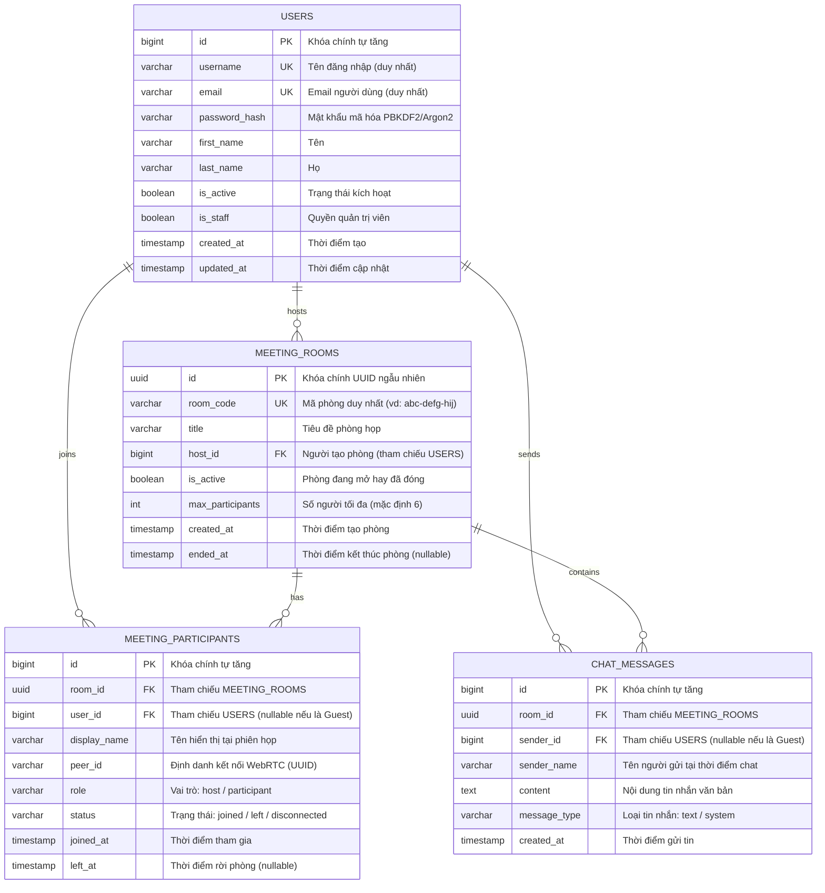

# THIẾT KẾ CƠ SỞ DỮ LIỆU (DATABASE DESIGN)
## DỰ ÁN: AI MEETING

---

## 1. TỔNG QUAN HỆ CƠ SỞ DỮ LIỆU
Hệ thống sử dụng hệ quản trị cơ sở dữ liệu quan hệ **PostgreSQL 16+** nhằm đảm bảo tính toàn vẹn dữ liệu (ACID), khả năng mở rộng, tối ưu hóa truy vấn qua chỉ mục (Indexes) và hỗ trợ kiểu dữ liệu mở rộng như UUID, JSONB khi cần thiết.

---

## 2. SƠ ĐỒ THỰC THỂ QUAN HỆ (ERD - ENTITY RELATIONSHIP DIAGRAM)

---

## 3. ĐẶC TẢ CHI TIẾT CÁC BẢNG DỮ LIỆU

### 3.1. Bảng `auth_user` (hoặc Kế thừa `User` model của Django)
Bảng lưu trữ thông tin tài khoản người dùng của hệ thống. Kế thừa tiêu chuẩn từ `django.contrib.auth.models.AbstractUser`.

| Cột (Field) | Kiểu dữ liệu | Ràng buộc | Mô tả |
| :--- | :--- | :--- | :--- |
| `id` | `BIGSERIAL` | `PRIMARY KEY` | Định danh người dùng |
| `username` | `VARCHAR(150)` | `NOT NULL, UNIQUE` | Tên tài khoản đăng nhập |
| `email` | `VARCHAR(254)` | `NOT NULL, UNIQUE` | Địa chỉ thư điện tử |
| `password` | `VARCHAR(128)` | `NOT NULL` | Chuỗi băm mật khẩu bảo mật |
| `first_name`| `VARCHAR(150)` | `NULLABLE` | Tên gọi |
| `last_name` | `VARCHAR(150)` | `NULLABLE` | Họ và đệm |
| `is_active` | `BOOLEAN` | `NOT NULL, DEFAULT TRUE` | Trạng thái hoạt động |
| `is_staff` | `BOOLEAN` | `NOT NULL, DEFAULT FALSE` | Có quyền truy cập Admin |
| `date_joined`| `TIMESTAMPTZ` | `NOT NULL, DEFAULT NOW()` | Thời điểm đăng ký |

- **Chỉ mục (Indexes):**
  - Index duy nhất tự động trên `username` và `email`.

---

### 3.2. Bảng `meeting_rooms`
Lưu trữ thông tin cấu hình và vòng đời của các phòng họp.

| Cột (Field) | Kiểu dữ liệu | Ràng buộc | Mô tả |
| :--- | :--- | :--- | :--- |
| `id` | `UUID` | `PRIMARY KEY, DEFAULT gen_random_uuid()` | Khóa chính chuẩn UUIDv4 |
| `room_code` | `VARCHAR(32)` | `NOT NULL, UNIQUE` | Mã định danh phòng ngắn (vd: `abc-defg-hij`) |
| `title` | `VARCHAR(255)` | `NOT NULL, DEFAULT 'Cuộc họp mới'` | Tên cuộc họp |
| `host_id` | `BIGINT` | `NOT NULL, FOREIGN KEY (auth_user.id)` | Người khởi tạo phòng |
| `is_active` | `BOOLEAN` | `NOT NULL, DEFAULT TRUE` | Trạng thái phòng (True: đang mở, False: đã đóng) |
| `max_participants`| `INTEGER` | `NOT NULL, DEFAULT 6` | Giới hạn số người tham gia (khuyến nghị cho Mesh) |
| `created_at`| `TIMESTAMPTZ` | `NOT NULL, DEFAULT NOW()` | Thời điểm tạo phòng |
| `ended_at` | `TIMESTAMPTZ` | `NULLABLE` | Thời điểm phòng kết thúc |

- **Chỉ mục (Indexes):**
  - `idx_meeting_rooms_code`: Index trên `room_code` để tăng tốc độ truy vấn khi client nhập mã vào phòng.
  - `idx_meeting_rooms_active`: Index trên `(is_active, created_at)` phục vụ lọc các phòng đang hoạt động.

---

### 3.3. Bảng `meeting_participants`
Ghi lại lịch sử các phiên tham gia phòng họp, phục vụ audit và thống kê thành viên.

| Cột (Field) | Kiểu dữ liệu | Ràng buộc | Mô tả |
| :--- | :--- | :--- | :--- |
| `id` | `BIGSERIAL` | `PRIMARY KEY` | Khóa chính tự tăng |
| `room_id` | `UUID` | `NOT NULL, FOREIGN KEY (meeting_rooms.id) ON DELETE CASCADE` | Tham chiếu phòng họp |
| `user_id` | `BIGINT` | `NULLABLE, FOREIGN KEY (auth_user.id) ON DELETE SET NULL` | Người dùng đã đăng nhập (NULL nếu là Guest) |
| `display_name`| `VARCHAR(100)`| `NOT NULL` | Tên hiển thị của người tham gia |
| `peer_id` | `VARCHAR(64)` | `NOT NULL` | Định danh phiên kết nối WebRTC (UUIDv4) |
| `role` | `VARCHAR(20)` | `NOT NULL, DEFAULT 'participant'` | Vai trò: `host` hoặc `participant` |
| `status` | `VARCHAR(20)` | `NOT NULL, DEFAULT 'joined'` | Trạng thái: `joined`, `left`, `disconnected` |
| `joined_at` | `TIMESTAMPTZ` | `NOT NULL, DEFAULT NOW()` | Thời điểm vào phòng |
| `left_at` | `TIMESTAMPTZ` | `NULLABLE` | Thời điểm rời phòng |

- **Chỉ mục (Indexes):**
  - `idx_participants_room_status`: Index trên `(room_id, status)` để đếm nhanh số thành viên đang online.
  - `idx_participants_peer`: Index trên `peer_id` để tra cứu nhanh khi ngắt kết nối.

---

### 3.4. Bảng `chat_messages` (Tùy chọn lưu trữ lịch sử)
Lưu lại các tin nhắn trao đổi trong phòng họp.

| Cột (Field) | Kiểu dữ liệu | Ràng buộc | Mô tả |
| :--- | :--- | :--- | :--- |
| `id` | `BIGSERIAL` | `PRIMARY KEY` | Khóa chính tự tăng |
| `room_id` | `UUID` | `NOT NULL, FOREIGN KEY (meeting_rooms.id) ON DELETE CASCADE` | Thuộc phòng họp nào |
| `sender_id` | `BIGINT` | `NULLABLE, FOREIGN KEY (auth_user.id) ON DELETE SET NULL` | Người gửi (NULL nếu Guest) |
| `sender_name`| `VARCHAR(100)`| `NOT NULL` | Tên người gửi hiển thị |
| `content` | `TEXT` | `NOT NULL` | Nội dung tin nhắn (tối đa 1000 ký tự) |
| `message_type`| `VARCHAR(20)`| `NOT NULL, DEFAULT 'text'` | Loại tin: `text`, `system` |
| `created_at`| `TIMESTAMPTZ` | `NOT NULL, DEFAULT NOW()` | Thời điểm gửi |

- **Chỉ mục (Indexes):**
  - `idx_chat_room_time`: Index trên `(room_id, created_at)` để lấy lịch sử tin nhắn theo thứ tự thời gian.

---

## 4. CHIẾN LƯỢC MÔ HÌNH HÓA VÀ DI TRÚ (MIGRATION STRATEGY)
1. Các model được định nghĩa trong Django App `meetings` và `authentication`.
2. Mọi khóa ngoại đều có cấu hình `on_delete` tường minh để bảo vệ tính toàn vẹn quan hệ.
3. Khi triển khai trên môi trường phát triển cục bộ nếu chưa có PostgreSQL, cấu hình Django cho phép linh hoạt sử dụng `sqlite3` qua biến môi trường để hỗ trợ kiểm thử nhanh chóng.
